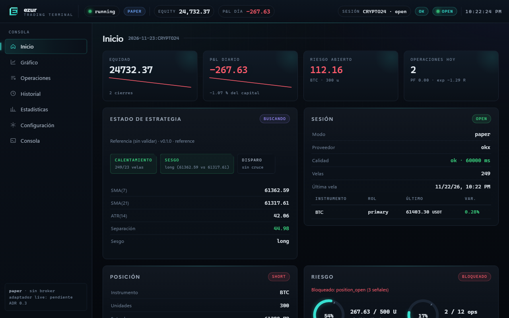
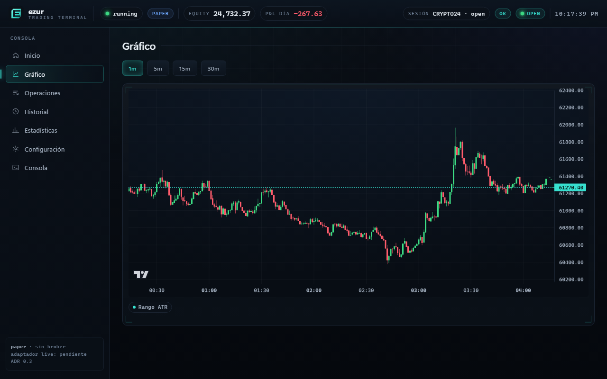
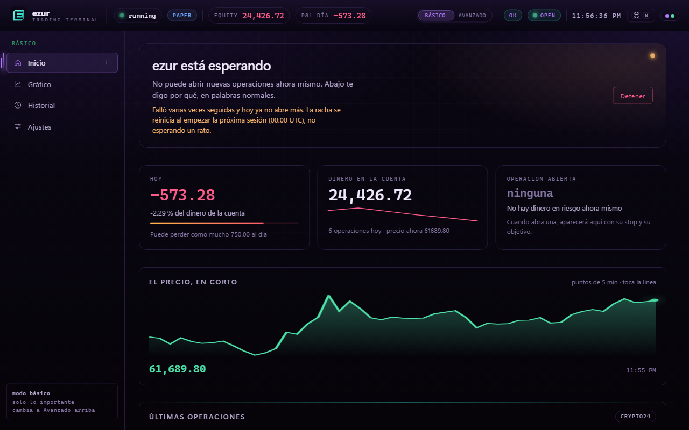
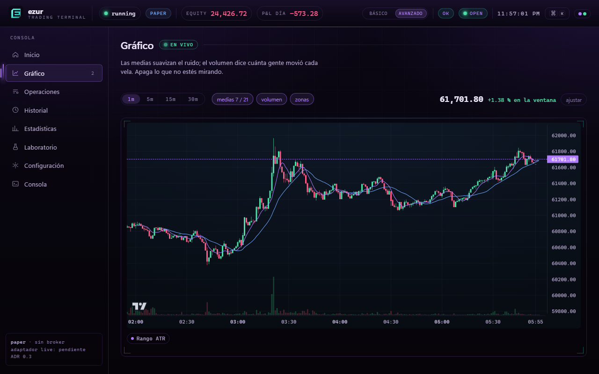
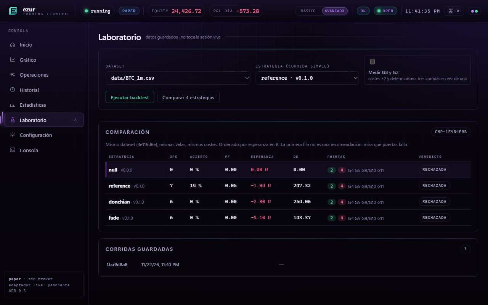

# ezur

**Terminal de trading algorítmico con validación honesta.** Motor determinista,
riesgo medido, puertas de validación versionadas y una interfaz que no inventa
nada. El nombre viene de *ezur*; el resto del repositorio sigue igual de serio.


Terminal local de trading algorítmico: motor determinista, gestión de riesgo,
ejecución paper, persistencia SQLite en WAL y dashboard web. La lógica de
estrategia es un plugin intercambiable: la infraestructura no conoce ni activos
ni reglas de entrada.

**Estado:** esqueleto completo y operativo (Fase 1) con simulación multi-sesión y
veredicto de validación automático. La estrategia incluida es una referencia sin
validar, no una ventaja de mercado.

## Arranque rápido

```bash
python -m pip install -r requirements.txt
cd frontend ; npm install ; npm run build ; cd ..
python run.py
```

Con el perfil que opera (datos reales, ejecución en papel) y su arranque propio:

```bash
start_paper.bat          # o: EZUR_PROFILE_DIR=profiles/okx python run.py
python -m server.paper --profile profiles/okx   # la cuenta, también con el bot parado
```

La cuenta vive en `profiles/okx/terminal.db`, no en el proceso: parar y arrancar
no borra el histórico, y cada operación cerrada se inserta una sola vez aunque
el backfill la vuelva a ver.

Panel en `http://127.0.0.1:8765`. El motor arranca **solo** (`auto_start`):
consume el feed y evalúa la estrategia sin intervención. Con
`"auto_start": false` en el perfil queda `idle` hasta `POST /api/bot/start`.

Con datos sintéticos y la estrategia de referencia:

```bash
EZUR_PROFILE_DIR=profiles/demo python run.py          # Windows: $env:EZUR_PROFILE_DIR="profiles/demo"
```

## Aplicación de escritorio (.exe)

Ventana nativa (WebView2) sobre el mismo servidor local. El motor, el riesgo y
las estrategias no cambian: `desktop.py` arranca el mismo `server.main:app`.

```bat
python -m pip install -r requirements.txt pyinstaller pywebview
cd frontend ; npm run build ; cd ..
python installer\make_icon.py
pyinstaller installer\ezur.spec --noconfirm --distpath dist_exe --workpath .build\pyi
dist_exe\ezur\ezur.exe
```

`desktop.py` levanta `server.main:app` en `127.0.0.1` con un puerto libre, espera
a que `/api/status` responda y abre la ventana. Se coloca en la carpeta del
ejecutable **antes** de importar el servidor, porque `frontend/dist`, `data/` y
`profiles/` se resuelven desde el directorio de trabajo.

| Pieza | Qué hace |
|---|---|
| `desktop.py` | lanzador: servidor en un hilo + ventana; `--self-test`, `--no-window`, `--port` |
| `installer/ezur.spec` | PyInstaller **onedir**; copia la UI, los perfiles y los CSV junto al `.exe` |
| `installer/make_icon.py` | genera `ezur.ico` con la geometría del logo a 7 tamaños |
| `installer/ezur.iss` | Inno Setup, instalación por usuario en `%LOCALAPPDATA%\ezur` |

Logs en `%LOCALAPPDATA%\ezur\logs\desktop.log`. En modo ventana no hay consola,
así que `sys.stdout` y `sys.stderr` se redirigen a ese fichero: un traceback no
se pierde. Las preferencias de la UI (tema, acento, tipo de gráfico) persisten en
`%LOCALAPPDATA%\ezur\webview` porque la ventana arranca con `private_mode=False`.

La configuración que trae el ejecutable es el perfil `demo` (estrategia
`reference`, datos simulados): recién instalado arranca solo y tiene algo que
evaluar. Sin eso, `strategy.id = "null"` dejaría Reanudar sin efecto.

Instalador (requiere Inno Setup 6):

```bat
winget install --id JRSoftware.InnoSetup -e
"%LOCALAPPDATA%\Programs\Inno Setup 6\ISCC.exe" installer\ezur.iss
```

El `winget` instala Inno Setup por usuario en `%LOCALAPPDATA%\Programs`; si lo
instalas para todos los usuarios, el compilador está en
`C:\Program Files (x86)\Inno Setup 6\ISCC.exe`.

Deja `dist_installer\ezur-setup-0.1.0.exe`. No se firma: un instalador sin
firma dispara SmartScreen y algunos antivirus marcan el bootloader de
PyInstaller; para distribuirlo fuera de tu máquina hace falta un certificado.

## Aviso de versión nueva

`GET /api/update` compara la versión instalada con un manifiesto JSON y la UI lo
enseña en un chip junto al selector de tema. Comprueba y avisa; **no descarga ni
ejecuta nada**. Sin firma, reemplazar el `.exe` en caliente es justo lo que un
antivirus marca con razón, así que instalar sigue siendo cosa tuya.

Sin canal configurado no se sale a la red: el chip solo dice la versión. Para
activarlo, publica este JSON donde la app pueda leerlo (un release de GitHub, tu
servidor, una carpeta compartida) y apunta la variable de entorno:

```json
{"version": "0.2.0", "url": "https://.../ezur-setup-0.2.0.exe", "notes": "arregla X"}
```

```bat
set EZUR_UPDATE_URL=https://mi-servidor/ezur/update.json
ezur.exe
```

`EZUR_UPDATE_CHECK=0` lo apaga. La respuesta se cachea seis horas y los fallos
dos minutos, para no golpear la red en cada recarga. También se puede consultar
sin abrir la ventana:

```bat
ezur.exe --check-update
```

## Simulación multi-sesión

```bash
python -m server.simulation --days 60 --bars 390 --out reports/backtest/simulation-60d.json
```

Ejecuta el motor real sobre sesiones sintéticas deterministas y escribe
estadísticas completas: global, por dirección, por hora, por día de la semana,
por mes y curva de equidad. Sirve para verificar la infraestructura; los datos
sintéticos no validan rentabilidad.

## Comandos

| Comando | Qué hace |
|---|---|
| `python -m pytest` | Suite del backend |
| `python -m server.paper --profile profiles/okx` | Cuenta de papel: gana o pierde, sin arrancar el servidor |
| `docs/ESTUDIO-2026-11-24.md` | Qué dice la evidencia sobre bots de trading con LLM, medida propia y calificación |
| `cd frontend && npm run test` | Suite de componentes |
| `cd frontend && npm run build` | `tsc --noEmit` + build de Vite |
| `python -m server.simulation --days 20` | Simulación multi-sesión |
| `python -m server.funnel` | Embudo de evaluación del ledger |
| `python -m server.walkforward` | Ventanas W1–W6 sobre una rejilla de parámetros |
| `python -m server.experiments` | Ledger de experimentos con veredictos |
| `python -m server.diagnostics` | Diagnóstico de SQLite en solo lectura; con `--profile` usa `<perfil>/terminal.db` y añade drawdown y parada dura; `--strict` sale con 1 si algo no cuadra |
| `python -m server.reset --dry-run` | Previsualiza el reinicio operativo |
| `python -m server.reset --yes` | Archiva estado y deja todo limpio |
| `python -m server.promotion --evidence bt.json --stress bt2x.json --cycle ciclo.json` | Decide si una configuración puede operar (sale con 1 si no) |
| `python -m server.equity --profile profiles/okx` | Compara la curva guardada con el libro; `--apply` la reconstruye con copia previa; `--reset-peak` reanuda tras una parada dura, con copia y evento |

## Estructura

```text
server/
  engine.py        ciclo de vela, sesión, control, recuperación
  snapshot.py      contrato v1 agnóstico
  schemas.py       contrato Pydantic del snapshot
  risk.py          autorización y dimensionado
  execution.py     fills, brackets, barras ambiguas
  db.py            Store SQLite WAL
  simulation.py    simulación multi-sesión
  stats.py         métricas descriptivas
  gates.py         puertas de validación como datos + veredicto
  stress.py        G8 (costes ×2) y G2 (determinismo) por re-ejecución
  integrity.py     G1/G3/G14: validador + hash reproducible
  confirmatory.py  sellado del holdout (una sola vez)
  experiments.py   ledger JSONL de experimentos
  diagnostics.py   inspección SQLite de solo lectura
  reset.py         reinicio operativo con backup
  strategy/        ← único lugar con lógica de estrategia
    base.py        contrato BaseStrategy
    registry.py    resolución por id
    null_strategy.py
    reference.py   referencia sin validar
    donchian.py    ruptura de canal (sin validar)
    fade.py        reversión a la media (sin validar)
    indicators.py  sma, stdev, atr, highest, lowest
  market/          feeds, CSV, sesiones, instrumentos, sintético
frontend/src/      React 18 + TypeScript + Lightweight Charts
docs/              arquitectura, plugins, UI, protocolo, operación, competencia
```

## Reglas que el código hace cumplir

- Ningún nombre de activo en `server/` (salvo `server/market/`) ni en
  `frontend/src/`: lo verifica `tests/test_no_hardcoded_instruments.py`.
- La estrategia no importa base de datos, motor, API ni ejecución.
- Una señal se ejecuta una sola vez; no hay segunda entrada con posición abierta.
- Una operación cerrada se guarda una sola vez: índice único parcial por señal.
- La curva de equity se reconstruye desde el libro y coincide con la cuenta de papel.
- El stop es obligatorio: sin `stop_price` no hay señal válida.
- Ante una vela que toca stop y objetivo, gana el stop, con diagnóstico auditable.
- LIVE exige adaptador implementado + `live_enabled` + confirmación explícita.
- Un `kind` de zona o marcador desconocido se descarta y se registra.
- Los desgloses por hora y por día usan la zona horaria de la sesión, no UTC.
- Un replay terminado deja el motor en `stopped`; no finge seguir corriendo.
- El marco de la estrategia (`strategy.timeframe`) es del motor y no del gráfico:
  agrupa el feed de 1 m en velas cerradas de 5, 15 o 30 m antes de evaluar, la
  vela abierta no cuenta y el snapshot publica el marco en uso.

## La puerta de promoción

Ganar un backtest no demuestra nada. Antes de operar, una configuración pasa
por la misma vara que el estudio:

| criterio | umbral |
|---|---|
| PF fuera de muestra | > 1 |
| operaciones fuera de muestra | >= 100 |
| coste ponderado por operación (fees totales / riesgo total) | < 0,25 R |
| PF con el coste duplicado | > 1 |
| PBO de su ciclo de selección | <= 0,2 |

```bash
python -m server.promotion --config profiles/okx/config.json --evidence bt.json --stress bt-2x.json --cycle CYCLE-BOT-1D.json
```

El coste se mide con la comisión y el `tick_value` del perfil que va a operar: `--config` es obligatorio, y una evidencia que no declara su modelo de ejecución no supera ese criterio. El número que decide es el **ponderado** (fees totales / riesgo total) y se mide sobre el mismo tramo fuera de muestra que el PF; la media simple por operación (fees/riesgo) se publica como distribución (mediana, p90, p99) y no aprueba nada. Sale con 1 si no está promovida. En el perfil, `"promotion": {"required": true,
"evidence": "...", "stress_evidence": "...", "cycle": "..."}` con
`"mode": "block"` impide arrancar, tanto por `auto_start` como a mano; con
`"mode": "reduce"` arranca, pero multiplica el riesgo efectivo por `size_factor`
y deja un evento con el criterio que falló. La reducción no se
escribe en `config.json`: el valor configurado se conserva y Ajustes y
Configuración muestran el efectivo. Apagada por defecto: encenderla es decisión
del perfil.

## Libros que cuadran

- `python -m server.equity --profile profiles/okx` enseña la diferencia entre la
  curva guardada y el libro; `--apply` la reescribe con copia previa. Es
  idempotente: dos pasadas dejan lo mismo.
- El contador del día se reconstruye al arrancar con las operaciones cerradas
  dentro de la sesión actual: un reinicio no arrastra el límite de ayer.
- Con `soft_brakes` los frenos recortan tamaño en vez de cerrar la puerta: 100 %
  hasta medio límite de drawdown, 25 % al límite y parada dura al doble. La
  racha de pérdidas baja a la mitad; el límite diario sigue siendo un muro.

## Qué está medido y qué no

| Hecho | Evidencia |
|---|---|
| Motor determinista | Mismo dataset ⇒ mismo hash de backtest |
| Snapshot conforme al contrato | Suites de backend y frontend, `tsc` limpio y build de Vite |
| Pipeline completo con trades reales | `reports/backtest/simulation-180d.json` |
| Ninguna rejilla de parámetros se salva | `reports/backtest/walkforward-reference.json` (6 combinaciones × 3 ventanas, todas negativas) |
| Estrategia de referencia rentable | **No.** Veredicto automático: RECHAZADA |
| Candidato de 15 m (stop 10 ATR) | Fuera de muestra PF 1,308; rechazado por PBO 0,441 (`CYCLE-BOT-15M`) |
| Veredicto reproducible | `GET /api/validation` evalúa G4–G13 y nombra lo no medible |
| Costes, determinismo e integridad medidos | G8, G2 y G1/G3/G14 se re-ejecutan, no se estiman |
| Única puerta abierta en un backtest | H1-H5 (holdout sellado), por diseño |

Ver `docs/INVESTIGACION_COMPETENCIA.md` para la comparación medida con Freqtrade,
Nautilus, LEAN y compañía, `docs/UI.md` para el sistema visual,
`docs/ESTRATEGIA_REFERENCIA.md` para los números y por qué no cuenta como
ventaja, `docs/COMO_ESCRIBIR_UNA_ESTRATEGIA.md` para el contrato de plugin,
`docs/PROTOCOLO_BACKTEST.md` para las puertas, `docs/OPERACION.md` para el día a
día y `docs/DECISIONES.md` para lo que falta decidir antes de la Fase 4.
`docs/INFORME_NOCHE_2026-11-23.md` recoge la sesión real del 22–23 de noviembre:
números medidos, comparación de estrategias y por qué ninguna se aprueba.

## Siguiente

1. Cerrar los 7 ADR de `docs/DECISIONES.md` (los valores por defecto del código
   ya están documentados allí para que cerrar cada ADR sea confirmarlos).
2. Datos reales y reconciliación de costes (Fase 2).
3. Escribir la estrategia candidata en `server/strategy/` y validarla con el
   protocolo de puertas antes de arriesgar capital.

## Lo que se copió de los mejores

`docs/INVESTIGACION_IA_TRADING.md` compara 33 repositorios con datos reales de
GitHub, papers y documentación. De ahí salieron, entre otras, dos piezas ya en
el código: el guardián de drawdown sobre el pico de capital (lección de
Freqtrade) y la cadena de hashes del ledger de experimentos (lección de
ai-hedge-fund).

## Datos reales

```bash
EZUR_PROFILE_DIR=profiles/okx python run.py    # Windows: $env:EZUR_PROFILE_DIR="profiles/okx"
```

Velas de 1 minuto de BTC-USDT desde la API pública de OKX, sin claves y sin
broker: paper trading con precios reales, backfill de 4 horas y sondeo cada 5 s.
El gráfico se redibuja cuando llega una vela nueva. Ver `docs/OPERACION.md`.




## Datos largos (Binance Vision)

La API de OKX da 600 velas; para validar una tendencia diaria hacen falta años.
Los ficheros mensuales públicos de Binance se descargan con su `.CHECKSUM`, se
guardan en caché y se convierten al CSV del bot:

```bash
python -m server.datasets vision --start 2020-01 --end 2026-10 \
    --out data/BTC_1m_binance.csv --cache data/vision
python -m server.datasets resample --in data/BTC_1m_binance.csv \
    --out data/BTC_1d_binance.csv --rule 1D
python -m server.backtest --dataset data/BTC_1d_binance.csv \
    --config config/okx-daily.json --strategy donchian \
    --params '{"channel":40,"atr_period":14,"stop_atr":1.5,"rr":2.0}' --gates
```

`config/okx-daily.json` es el perfil de **validación**, no el que opera: mismo
instrumento, capital 1 M para que el 1 % de riesgo dé unidades reales,
`tick_value` 0,01 (el precio de un tick; 1e-05 deja el tamaño en el tope de 300
unidades y no cierra nada), `max_stop_ticks` sin tope y el freno por drawdown
desactivado. Con `profiles/okx/config.json` el mismo comando devuelve **1
operación**: el tope de 40.000 ticks rechaza 180 de las 181 señales diarias y el
freno del 5 % corta la serie tras la primera pérdida. El perfil que opera no se
toca; cambiarlo cambiaría el sizing en vivo.

Medido el 2026-11-24: **3.591.915 velas de 1 m** (2020-01-01 → 2026-10-31) y
**2.496 velas diarias**, sin un solo día ausente. Donchian sobre ese histórico,
comisión 5 pb por lado, 1 % de riesgo:

| Canal | Ops | Acierto | PF | Esperanza | DD | Veredicto |
|---|---|---|---|---|---|---|
| 20 | 117 | 37,6 % | 1,142 | +0,097 R | 7,84 % | RECHAZADA |
| 40 | 88 | 37,5 % | 1,138 | +0,096 R | 10,65 % | RECHAZADA |
| 60 | 70 | 40,0 % | 1,253 | +0,173 R | 6,04 % | RECHAZADA |

La tendencia existe —PF > 1,1 y P&L positivo en los tres canales— pero falla
G5/G6, G9/G10 (sin las cinco mejores operaciones el resultado es negativo) y G11
(el IC80 de la esperanza toca cero). **Positivo no es lo mismo que distinguible
del ruido**, y coincide con el laboratorio: t = 1,66 frente a 3,0.

Un backtest diario con el perfil tal cual no mide la estrategia, mide la
configuración: `max_stop_ticks` (40.000 ticks = 400 $) rechaza todo stop diario,
el guardián de drawdown del 5 % detiene la serie tras la primera pérdida, y
`tick_value` (1e-05 con tick 0,01 y 1 unidad = 1 BTC) hace que el tamaño salga
en el tope de 300 unidades. El perfil de validación está en `config/okx-daily.json`
y no toca los perfiles que operan.

### 15 m y 1 h: cuánto cuesta operar

Misma ventana (2025-01 → 2026-10, 963.360 velas de 1 m), parámetros por defecto
de cada estrategia, una operación diaria como tope, 5 pb por lado. Entre
paréntesis, la misma corrida con comisión cero: la diferencia es el coste.

| Marco | reference | donchian | fade | coste por operación |
|---|---|---|---|---|
| 1 h | −0,139 (+0,059) | −0,046 (+0,061) | −0,222 (−0,091) | 0,08–0,13 R |
| 15 m | −0,232 (−0,036) | −0,367 (−0,111) | −0,364 (−0,067) | 0,20–0,30 R |
| 1 m | −1,548 (+0,061) | −2,379 (+0,058) | −2,491 (+0,027) | 1,6–2,5 R |

El coste cae veinte veces de 1 m a 1 h, como era de esperar: una comisión fija
pesa menos cuanto más ancho es el stop. Estas cifras son nominales
(fees / operaciones / presupuesto), la unidad de aquella medición; la puerta
actual usa el ponderado por riesgo real, que con stops estrechos puede ser
varias veces mayor. Pero **la señal no aparece**: sin
comisión los tres marcos intraday están entre −0,11 y +0,06 R, y lo positivo de
1 m es el artefacto del tope — una operación al día, la primera. Solo el diario
da esperanza neta positiva (+0,096 R con las 2.496 velas).

En intraday el problema no es solo el coste: es que no hay borde que pagarlo.
Subir de marco abarata operar; no crea señal.

### 15 m con stop ancho: el candidato que casi pasa

Cambiar el marco a 15 m y dejar el stop en 10 ATR (objetivo 1 R) sobre
`data/BTC_15m_2025.csv` (64.224 velas) da el mejor resultado medido hasta hoy:
233 operaciones, 56,7 % de acierto, PF 1,204 y +0,092 R por operación. Fuera de
muestra, 105 operaciones, PF 1,308, coste 0,049 R y PF 1,184 con el coste
duplicado.

La puerta lo rechaza por dos sitios: G5 (PF < 1,25 y esperanza < 0,10 R) y el
PBO de su ciclo en 15 m (0,441 > 0,2). El histograma lo explica: todo el
resultado son dos barras, +0,95 R y −1,03 R, o sea una apuesta 1:1 con 56,7 % de
acierto cuando el empate está en 52,6 %. Con 233 tiradas eso es z ≈ 1,4, no una
ventaja. `config/okx-15m-paper-regime.json` guarda el candidato medido y
`profiles/okx/config.json` lo conserva **bloqueado**: el perfil no arranca sin
promoción.

El otro freno nuevo, `risk.min_stop_ticks`, rechaza señales con el stop pegado a
la entrada. En 1 m sube el PF de 0,476 a 0,512 y recorta la peor racha de 27 a
11 pérdidas seguidas, pero el bruto del filtro (474 $) no paga sus comisiones
(140.209 $): el mínimo no rescata el marco de 1 m. Ver `docs/MEDICIONES.md`.

### Perfil agresivo

`config/agresivo.json` (activarlo es `cp config/agresivo.json
profiles/agresivo/config.json`): 5 % por operación, stop 3×ATR, sin freno de
drawdown ni de racha, hasta 50 operaciones al día y 1.000 unidades. Medido sobre
las 2.496 velas diarias con 5 pb por lado:

| Stop | Riesgo | Ops | Acierto | PF | Esperanza | P&L | DD |
|---|---|---|---|---|---|---|---|
| 1,2 ATR | 5 % | 131 | 35,1 % | 0,96 | +0,02 R | −203.597 | 80,3 % |
| 3,0 ATR | 5 % | 45 | 51,1 % | 1,79 | +0,52 R | +1.793.957 | 42,9 % |
| 3,0 ATR | 2 % | 45 | 51,1 % | 1,88 | +0,52 R | +469.868 | 9,9 % |

El stop ancho es lo que mueve el resultado: el mismo Donchian pasa de 35 % a
51 % de acierto y de PF 0,96 a 1,79, porque deja respirar la tendencia en vez de
sacarlo por ruido. Pero 45 operaciones no llegan al mínimo de 80 (G4) y el 5 % de
riesgo lleva el drawdown al 43 % (G6): el veredicto sigue siendo RECHAZADA. Al
2 % el drawdown cae al 10 % sin tocar la esperanza por operación.

Con 25.000 de capital el perfil no puede abrir ni una unidad: un stop diario de
3 ATR vale unos 2.000 $ y una unidad es 1 BTC, así que el perfil usa 1 M. Para
operar BTC con 25.000 haría falta tamaño fraccionario, que el motor no modela.

### Juzgar una corrida: fuera de muestra, rechazos y JSON

```bash
python -m server.backtest --dataset data/BTC_1h_2025.csv \
    --config config/okx-daily.json --strategy donchian \
    --params '{"channel":20,"atr_period":14,"stop_atr":1.2,"rr":2.0}' \
    --split 2026-01-01 --gates --out .build/1h-donchian.json
```

`--split` parte por fecha de cierre y mide dentro y fuera de muestra por
separado, con la degradación entre ambos: sin eso, cualquier PF es in-sample.
`--out` guarda la corrida entera —identidad del dataset, hash de configuración,
métricas, puertas y reparto— para comparar dos resultados sin volver a ejecutar.

La línea `rechazos` explica por qué una corrida da pocas operaciones: en el
ejemplo, 688 señales cayeron por el tope diario y 340 porque ya había posición
abierta; no es que la estrategia no viera oportunidades. Y `coste` traduce las
comisiones a R por operación, que es la cifra que decide si un marco es viable.

## Umbrales: un solo fichero

`config/gates.json` es la fuente única. Lo leen el bot (`server/gates.py`) y el
motor de estrategias (`runner/gates.py`), y cada lado tiene un test que falla si
su código deja de leerlo o si el documento no cuadra con lo que espera. Cambiar
`min_profit_factor` una vez lo cambia en los dos, en vez de dejar que un
veredicto dependa de qué copia se acuerde actualizar.

## Bot y motor, un solo mando

El motor de estrategias sigue en su árbol porque necesita pandas y su propio
venv; meterlo en el .exe multiplicaría el instalador y duplicaría el motor. Lo
que se une es el mando: un comando del bot lo descubre, lo ejecuta y guarda cada
veredicto en `data/research/runs.jsonl`.

```bash
python -m server.research --seeds     # familias que nunca se han medido
python -m server.research --generate  # variantes de las specs semilla
python -m server.research --list      # specs y estado
python -m server.research --once      # la siguiente pendiente
python -m server.research --loop      # sigue buscando mientras el bot corre
python -m server.research --report    # qué ha encontrado, por familia y marco
python -m server.research --cycle     # mide el ciclo de selección (PBO, DSR, MinBTL, WFA)
python -m server.research --rank      # qué spec está más cerca de pasar
python -m server.research --vault     # memoria navegable en Markdown
python -m server.research --vault-lint  # enlaces rotos y notas huérfanas
```

`--seeds` escribe tres semillas nuevas heredando riesgo, costes y validación de
una spec real del motor, a partir de `config/research_seeds.json` — en `server/`
no se nombra ninguna estrategia, igual que con los umbrales: reversión z-score en 1 h y 4 h, y opening range
breakout en 5 m. La tendencia lleva seis semillas y noventa y seis variantes sin
pasar el filtro; probar el lado contrario y otro patrón no es más de lo mismo.

Dos límites del motor que conviene saber antes de sembrar: `orb_session` cierra
la sesión a 96 barras fijas (en 1 h serían cuatro días, así que se mide en 5 m
con la primera hora como rango) y pandas 3 rechaza los alias `15m`/`30m` aunque
el esquema los admita, de modo que cualquier marco de minutos salvo 5 m revienta
al resamplear.

`--generate` barre los parámetros que cada spec declara —`N` 20/40/60, `atr_k`
1,2/2,0/3,0 y `tp_r` 2/4— y escribe las candidatas en `data/research/specs`.
Solo se barre lo declarado (una spec sin `N` no recibe uno inventado), la
combinación idéntica a la semilla se descarta y repetir el comando no duplica
nada. De las seis semillas salen 96 candidatas.

Cada spec se identifica por la huella de su JSON, así que reiniciar el bucle no
repite lo ya medido; un fallo no marca la spec como medida y tres fallos seguidos
paran el bucle para no quemar tiempo. La ruta del motor se toma de
`EZUR_RESEARCH_HOME` (o de la ubicación por defecto) y su intérprete de
`EZUR_RESEARCH_PYTHON` o del venv del propio motor.

Los tres contratos compartidos: el fichero de umbrales, los datos de
`data/*.csv` que ambos leen y el ledger de veredictos.

`--report` lee ese ledger y responde a la única pregunta que importa cuando el
bucle lleva horas: cuántas specs se midieron por familia y marco, cuántas
pasaron y cuáles. Sin él, cien corridas son cien líneas.

`--cycle` ataca la raíz del problema anterior: PBO, DSR, MinBTL y WFA no son
propiedades de un backtest sino de una **selección**, y el motor los deja nulos
en una corrida suelta. Su `selection_cycle` los calcula sobre un universo de
vecinos y escribe un JSON que el runner sabe consumir; el bot lo lanza desde
`--cycle` (por defecto sobre la mejor spec del ranking), lo guarda en
`data/research/cycles` y lo pasa explícito con `--validation`, para que el
ciclo de una familia no juzgue a otra por ser el más reciente del directorio.

`--rank` ordena los artefactos por cercanía a pasar: puertas superadas y, a
igualdad, cuánto le faltó a la más cercana en fracción de su umbral. Es triaje,
no una probabilidad —cada puerta mide otra cosa— y evita releer sesenta y nueve
rechazos a mano para decidir qué mirar primero.

Antes de ordenar, audita las puertas: una que da el mismo valor en todas las
specs no distingue nada y se queda fuera del margen (se sigue mostrando, como
sospechosa). En este motor, PBO, DSR, CPCV y WFA vienen del ciclo de selección
—su propio `note` lo dice— así que llegan idénticas a cada spec y no pueden
ordenar ninguna. `--rank` enseña cuáles deja fuera y por qué.

`--vault` lleva eso un paso más allá: cada artefacto del motor se convierte en
una nota de Markdown enlazada —cifras, puertas que fallaron con su valor y su
umbral, y procedencia— agrupada por familia, por marco y por día. La idea es la
de un segundo cerebro tipo Obsidian (el patrón de [claude-obsidian](https://github.com/AgriciDaniel/claude-obsidian):
Markdown que tú posees, enlaces entre notas y un chequeo de salud), aplicada a
lo que este bot ya mide. El vault se genera desde los JSON del motor, así que no
inventa ni una cifra, y `--vault-lint` avisa de enlaces rotos y notas huérfanas
antes de que el wiki se desordene.

## Alertas

Un webhook opcional envía los eventos `warn`/`error` (parada de emergencia,
límite de pérdida, rechazos) como JSON, en un hilo aparte, con deduplicación y
contadores visibles en `GET /api/alerts`. Apagado por defecto.

## Laboratorio

```bash
python -m server.datasets pull --config profiles/okx/config.json --bars 600 --out data/BTC_1m.csv
```

En el panel: **Avanzado → Laboratorio**. Elige dataset, corre una estrategia o
compara todas; cada fila trae su veredicto y las puertas que falla. Nada de eso
toca el motor que está operando.

## Interfaz

HUD oscuro con un solo acento, cifras tabulares y tres medidores propios: curva
de equidad, sparkline por KPI y arcos de uso de límites. Todo dibujado a mano en
SVG salvo los dos gráficos de velas (`lightweight-charts`). Ver `docs/UI.md`.

Dos densidades sobre el mismo snapshot: **Básico** (cuatro vistas, frases en vez
de códigos, dinero en vez de R) y **Avanzado** (las siete vistas, fases,
métricas, puertas y consola). El interruptor está en el HUD y se recuerda.

| Básico | Gráfico con capas | Laboratorio |
|---|---|---|
|  |  |  |

## Tres estrategias, un motor

El repositorio trae tres plugins con lógicas incompatibles entre sí. Ninguno se
tocó fuera de `server/strategy/`: el motor, el snapshot, la API y la interfaz no
saben cuál está corriendo.

| Estrategia | Ops | WR % | PF | Exp R | P&L neto | DD | Peor racha | Veredicto |
|---|---:|---:|---:|---:|---:|---:|---:|---|
| `reference` | 180 | 40.0 | 0.372 | -0.558 | -1526.5 | 1570.62 | 10 | RECHAZADA |
| `donchian` | 180 | 27.8 | 0.271 | -0.776 | -1998.18 | 1998.18 | 12 | RECHAZADA |
| `fade` | 180 | 19.4 | 0.122 | -0.9 | -1910.5 | 1919.65 | 19 | RECHAZADA |

Simulación de 60 sesiones × 390 velas sintéticas, dimensionado por riesgo
(hasta 5 unidades por operación).
Repetible con `python -m server.simulation --days 60 --bars 390 --strategy <id>`.

Las tres pierden. Sobre un paseo aleatorio sin estructura, cualquier regla paga
comisiones y se queda sin ventaja: eso es exactamente lo que el arnés debe decir.
Si alguna hubiera aprobado en datos sintéticos, el problema sería el arnés.
