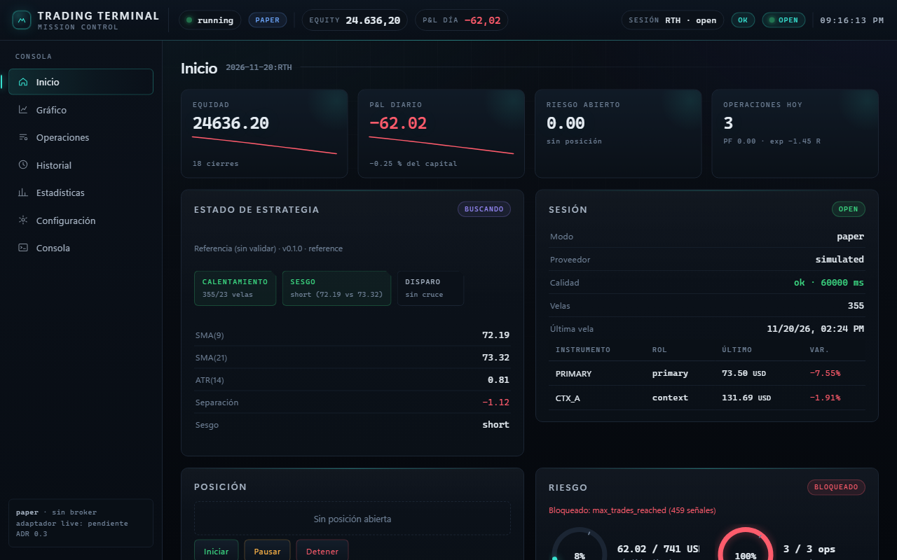

# ezur

**Terminal de trading algorítmico con validación honesta.** Motor determinista,
riesgo medido, puertas de validación versionadas y una interfaz que no inventa
nada. El nombre viene de *ezur*; el resto del repositorio sigue igual de serio.


Terminal local de trading algorítmico: motor determinista, gestión de riesgo,
ejecución paper, persistencia SQLite en WAL y dashboard web. La lógica de
estrategia es un plugin intercambiable: la infraestructura no conoce ni activos
ni reglas de entrada.

**Estado:** esqueleto completo y operativo (Fase 1) con simulación multi-sesión y
veredicto de validación automático. La estrategia incluida es una referencia sin
validar, no una ventaja de mercado.

## Arranque rápido

```bash
python -m pip install -r requirements.txt
cd frontend ; npm install ; npm run build ; cd ..
python run.py
```

Panel en `http://127.0.0.1:8765`. El motor arranca **detenido**: hay que pulsar
*Iniciar* en la vista de Inicio o llamar `POST /api/bot/start`.

Con datos sintéticos y la estrategia de referencia:

```bash
EZUR_PROFILE_DIR=profiles/demo python run.py          # Windows: $env:EZUR_PROFILE_DIR="profiles/demo"
```

## Simulación multi-sesión

```bash
python -m server.simulation --days 60 --bars 390 --out reports/backtest/simulation-60d.json
```

Ejecuta el motor real sobre sesiones sintéticas deterministas y escribe
estadísticas completas: global, por dirección, por hora, por día de la semana,
por mes y curva de equidad. Sirve para verificar la infraestructura; los datos
sintéticos no validan rentabilidad.

## Comandos

| Comando | Qué hace |
|---|---|
| `python -m pytest` | Suite del backend |
| `cd frontend && npm run test` | Suite de componentes |
| `cd frontend && npm run build` | `tsc --noEmit` + build de Vite |
| `python -m server.simulation --days 20` | Simulación multi-sesión |
| `python -m server.funnel` | Embudo de evaluación del ledger |
| `python -m server.walkforward` | Ventanas W1–W6 sobre una rejilla de parámetros |
| `python -m server.experiments` | Ledger de experimentos con veredictos |
| `python -m server.diagnostics` | Diagnóstico de SQLite en solo lectura |
| `python -m server.reset --dry-run` | Previsualiza el reinicio operativo |
| `python -m server.reset --yes` | Archiva estado y deja todo limpio |

## Estructura

```text
server/
  engine.py        ciclo de vela, sesión, control, recuperación
  snapshot.py      contrato v1 agnóstico
  schemas.py       contrato Pydantic del snapshot
  risk.py          autorización y dimensionado
  execution.py     fills, brackets, barras ambiguas
  db.py            Store SQLite WAL
  simulation.py    simulación multi-sesión
  stats.py         métricas descriptivas
  gates.py         puertas de validación como datos + veredicto
  stress.py        G8 (costes ×2) y G2 (determinismo) por re-ejecución
  integrity.py     G1/G3/G14: validador + hash reproducible
  confirmatory.py  sellado del holdout (una sola vez)
  experiments.py   ledger JSONL de experimentos
  diagnostics.py   inspección SQLite de solo lectura
  reset.py         reinicio operativo con backup
  strategy/        ← único lugar con lógica de estrategia
    base.py        contrato BaseStrategy
    registry.py    resolución por id
    null_strategy.py
    reference.py   referencia sin validar
    donchian.py    ruptura de canal (sin validar)
    fade.py        reversión a la media (sin validar)
    indicators.py  sma, stdev, atr, highest, lowest
  market/          feeds, CSV, sesiones, instrumentos, sintético
frontend/src/      React 18 + TypeScript + Lightweight Charts
docs/              arquitectura, plugins, UI, protocolo, operación, competencia
```

## Reglas que el código hace cumplir

- Ningún nombre de activo en `server/` (salvo `server/market/`) ni en
  `frontend/src/`: lo verifica `tests/test_no_hardcoded_instruments.py`.
- La estrategia no importa base de datos, motor, API ni ejecución.
- Una señal se ejecuta una sola vez; no hay segunda entrada con posición abierta.
- El stop es obligatorio: sin `stop_price` no hay señal válida.
- Ante una vela que toca stop y objetivo, gana el stop, con diagnóstico auditable.
- LIVE exige adaptador implementado + `live_enabled` + confirmación explícita.
- Un `kind` de zona o marcador desconocido se descarta y se registra.
- Los desgloses por hora y por día usan la zona horaria de la sesión, no UTC.
- Un replay terminado deja el motor en `stopped`; no finge seguir corriendo.

## Qué está medido y qué no

| Hecho | Evidencia |
|---|---|
| Motor determinista | Mismo dataset ⇒ mismo hash de backtest |
| Snapshot conforme al contrato | 309 tests de backend, 18 de frontend, 96 % de cobertura |
| Pipeline completo con trades reales | `reports/backtest/simulation-180d.json` |
| Ninguna rejilla de parámetros se salva | `reports/backtest/walkforward-reference.json` (6 combinaciones × 3 ventanas, todas negativas) |
| Estrategia de referencia rentable | **No.** Veredicto automático: RECHAZADA |
| Veredicto reproducible | `GET /api/validation` evalúa G4–G13 y nombra lo no medible |
| Costes, determinismo e integridad medidos | G8, G2 y G1/G3/G14 se re-ejecutan, no se estiman |
| Única puerta abierta en un backtest | H1-H5 (holdout sellado), por diseño |

Ver `docs/INVESTIGACION_COMPETENCIA.md` para la comparación medida con Freqtrade,
Nautilus, LEAN y compañía, `docs/UI.md` para el sistema visual,
`docs/ESTRATEGIA_REFERENCIA.md` para los números y por qué no cuenta como
ventaja, `docs/COMO_ESCRIBIR_UNA_ESTRATEGIA.md` para el contrato de plugin,
`docs/PROTOCOLO_BACKTEST.md` para las puertas, `docs/OPERACION.md` para el día a
día y `docs/DECISIONES.md` para lo que falta decidir antes de la Fase 4.

## Siguiente

1. Cerrar los 7 ADR de `docs/DECISIONES.md` (los valores por defecto del código
   ya están documentados allí para que cerrar cada ADR sea confirmarlos).
2. Datos reales y reconciliación de costes (Fase 2).
3. Escribir la estrategia candidata en `server/strategy/` y validarla con el
   protocolo de puertas antes de arriesgar capital.

## Lo que se copió de los mejores

`docs/INVESTIGACION_IA_TRADING.md` compara 33 repositorios con datos reales de
GitHub, papers y documentación. De ahí salieron, entre otras, dos piezas ya en
el código: el guardián de drawdown sobre el pico de capital (lección de
Freqtrade) y la cadena de hashes del ledger de experimentos (lección de
ai-hedge-fund).

## Datos reales

```bash
EZUR_PROFILE_DIR=profiles/okx python run.py    # Windows: $env:EZUR_PROFILE_DIR="profiles/okx"
```

Velas de 1 minuto de BTC-USDT desde la API pública de OKX, sin claves y sin
broker: paper trading con precios reales, backfill de 4 horas y sondeo cada 5 s.
El gráfico se redibuja cuando llega una vela nueva. Ver `docs/OPERACION.md`.


## Alertas

Un webhook opcional envía los eventos `warn`/`error` (parada de emergencia,
límite de pérdida, rechazos) como JSON, en un hilo aparte, con deduplicación y
contadores visibles en `GET /api/alerts`. Apagado por defecto.

## Interfaz

HUD oscuro con un solo acento, cifras tabulares y tres medidores propios: curva
de equidad, sparkline por KPI y arcos de uso de límites. Todo dibujado a mano en
SVG salvo los dos gráficos de velas (`lightweight-charts`). Ver `docs/UI.md`.



## Tres estrategias, un motor

El repositorio trae tres plugins con lógicas incompatibles entre sí. Ninguno se
tocó fuera de `server/strategy/`: el motor, el snapshot, la API y la interfaz no
saben cuál está corriendo.

| Estrategia | Ops | WR % | PF | Exp R | P&L neto | DD | Peor racha | Veredicto |
|---|---:|---:|---:|---:|---:|---:|---:|---|
| `reference` | 180 | 40.0 | 0.372 | -0.558 | -1526.5 | 1570.62 | 10 | RECHAZADA |
| `donchian` | 180 | 27.8 | 0.271 | -0.776 | -1998.18 | 1998.18 | 12 | RECHAZADA |
| `fade` | 180 | 19.4 | 0.122 | -0.9 | -1910.5 | 1919.65 | 19 | RECHAZADA |

Simulación de 60 sesiones × 390 velas sintéticas, dimensionado por riesgo
(hasta 5 unidades por operación).
Repetible con `python -m server.simulation --days 60 --bars 390 --strategy <id>`.

Las tres pierden. Sobre un paseo aleatorio sin estructura, cualquier regla paga
comisiones y se queda sin ventaja: eso es exactamente lo que el arnés debe decir.
Si alguna hubiera aprobado en datos sintéticos, el problema sería el arnés.
